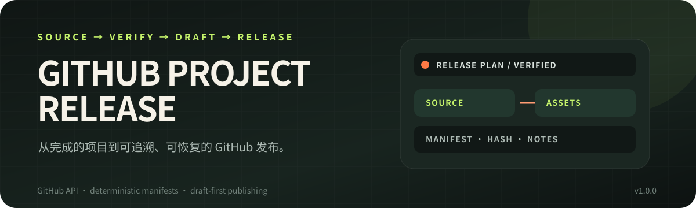
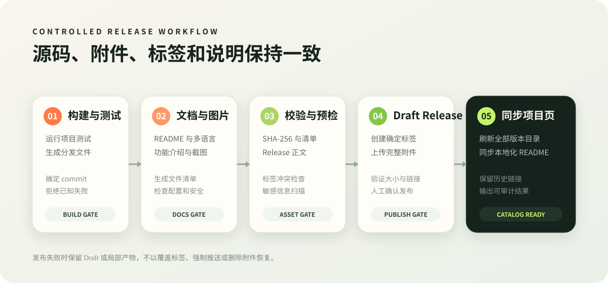

<p align="center">
  
</p>

<h1 align="center">GitHub Project Release</h1>

<p align="center">
  <strong>Turn a finished project into a publishable, traceable, and recoverable GitHub repository and release.</strong>
</p>

<p align="center">
  
  
  
  
</p>

<p align="center">
  <strong>English</strong>
  ·
  <a href="README.md">简体中文</a>
  ·
  <a href="README.zh-TW.md">繁體中文</a>
</p>

<p align="center">
  <a href="https://github.com/huaaorain/github-project-release/releases/latest"><strong>Download latest</strong></a>
  ·
  <a href="#core-capabilities">Core capabilities</a>
  ·
  <a href="#installation">Installation</a>
  ·
  <a href="#usage">Usage</a>
  ·
  <a href="#all-releases">All releases</a>
  ·
  <a href="https://github.com/huaaorain/github-project-release/issues">Report an issue</a>
</p>

---

## Why this exists

Publishing a finished project spans Git commits, build outputs, Release assets, README content, version notes, and historical download links. Manual work makes it easy to:

- mix source and generated artifacts in one repository;
- create mismatches between a tag, a commit, and a release;
- omit compatibility changes from release notes;
- publish files without explaining what they contain;
- lose useful historical download links;
- let localized READMEs drift after a release.

**GitHub Project Release** organizes these steps into a controlled workflow. It defaults to putting source code in Git while keeping executables and distributables in GitHub Releases.

## Core capabilities

<table>
  <thead>
    <tr>
      <th>Module</th>
      <th>What it does</th>
    </tr>
  </thead>
  <tbody>
    <tr>
      <td><strong>First&#8239;publish</strong></td>
      <td>Inspects the project, creates a release specification and GitHub repository, then pushes source after confirmation.</td>
    </tr>
    <tr>
      <td><strong>Version&#8239;release</strong></td>
      <td>Creates tags, Draft Releases, release notes, and downloadable assets from a confirmed commit.</td>
    </tr>
    <tr>
      <td><strong>File&#8239;manifest</strong></td>
      <td>Records each asset's purpose, type, size, and SHA-256 in machine- and human-readable forms.</td>
    </tr>
    <tr>
      <td><strong>Project&#8239;page</strong></td>
      <td>Builds a README with product context, real imagery, installation steps, limitations, and version downloads.</td>
    </tr>
    <tr>
      <td><strong>Localization</strong></td>
      <td>Maintains complete README translations, language links, and localized release catalogs.</td>
    </tr>
    <tr>
      <td><strong>Recovery</strong></td>
      <td>Resumes Draft asset uploads and refuses to fake success through force-pushes, moved tags, or overwritten releases.</td>
    </tr>
  </tbody>
</table>

## Release workflow



_This diagram describes the actual release process. It is not an application screenshot._

Every release moves through build and test, documentation and media, asset manifests, preflight, Draft Release, verification, publishing, and catalog refresh. Failures stop in an inspectable state instead of deleting tags or overwriting an existing release.

## Installation

Clone or extract this repository into:

```text
${CODEX_HOME}/skills/github-project-release
```

On Windows, the default location is usually:

```text
C:\Users\<USER>\.codex\skills\github-project-release
```

Reopen Codex, then invoke the skill explicitly:

```text
$github-project-release
```

Alternatively, download `github-project-release.zip` from Releases and place the whole `github-project-release/` directory in the skills path. Do not copy only `SKILL.md`; scripts, templates, and references are part of the workflow.

## Usage

After the project has passed its own tests and build:

```text
Use $github-project-release to publish this project to GitHub.
```

Common scoped requests:

```text
Use $github-project-release to create a Draft Release for v0.2.0.
Use $github-project-release to refresh the README and localized release catalogs.
Use $github-project-release to update an existing Release body without changing its assets.
```

## Safety boundaries

- Obtain authorization before creating a repository, pushing commits, or publishing a release.
- Create a Draft Release by default and publish only after verification.
- Keep executables, archives, runtimes, and extension packs out of Git.
- Record the commit, tag, file purposes, sizes, and checksums in every release manifest.
- Never print or persist GitHub tokens, and never place credentials in a remote URL.
- Never force-push, move a published tag, or overwrite an existing release.
- When real screenshots are unavailable, use a clearly labeled workflow diagram instead of presenting generated artwork as product UI.
- Start a project's first public release at `0.1.0` unless the user explicitly chooses another initial version.

## Requirements

- Python 3.10 or newer
- Git
- Write access to the target GitHub repository
- `GITHUB_TOKEN` or `GH_TOKEN` for repository, Release, and metadata operations
- The project's own build, test, and screenshot environment

Run the bundled tests:

```powershell
python .\scripts\test_release_manager.py
```

Inspect the helper commands:

```powershell
python .\scripts\release_manager.py --help
```

## Project structure

```text
github-project-release/
├─ SKILL.md
├─ agents/
├─ assets/
├─ references/
└─ scripts/
   ├─ release_manager.py
   └─ test_release_manager.py
```

`SKILL.md` contains the core decisions and safety rules. Detailed workflows, README guidance, media requirements, and release-note contracts are loaded only when needed. `release_manager.py` uses the Python standard library, Git, and the GitHub API; GitHub CLI is not required.

## Known limitations

- GitHub README files do not execute JavaScript, so language links open separate localized files.
- Automatic screenshots require a safe demo mode that the project can run.
- Code diffs cannot fully determine product impact; release notes still need a review pass.
- A GitHub Release asset is normally limited to 2 GiB per file.
- This repository does not currently declare an open-source license.

## Release history

- [0.1.0: first public release](docs/releases/v0.1.0.md)

## All releases

<!-- release-catalog:start -->
Latest: [GitHub Project Release 0.1.0](https://github.com/huaaorain/github-project-release/releases/tag/v0.1.0)

| Version | Published | Release notes |
| --- | --- | --- |
| `v0.1.0` | 2026-10-27 | [Open](https://github.com/huaaorain/github-project-release/releases/tag/v0.1.0) |

<details>
<summary><strong>All version downloads</strong></summary>

### GitHub Project Release 0.1.0

Release notes: [Open](https://github.com/huaaorain/github-project-release/releases/tag/v0.1.0)

- [FILE_MANIFEST.md](https://github.com/huaaorain/github-project-release/releases/download/v0.1.0/FILE_MANIFEST.md) — 485 B
- [github-project-release.zip](https://github.com/huaaorain/github-project-release/releases/download/v0.1.0/github-project-release.zip) — 44.3 KB
- [release-manifest.json](https://github.com/huaaorain/github-project-release/releases/download/v0.1.0/release-manifest.json) — 729 B
- [SHA256SUMS.txt](https://github.com/huaaorain/github-project-release/releases/download/v0.1.0/SHA256SUMS.txt) — 93 B
- [Source code (zip)](https://github.com/huaaorain/github-project-release/archive/refs/tags/v0.1.0.zip)
- [Source code (tar.gz)](https://github.com/huaaorain/github-project-release/archive/refs/tags/v0.1.0.tar.gz)

</details>
<!-- release-catalog:end -->

## Acknowledgements

- [GitHub REST API](https://docs.github.com/rest)
- [Best-README-Template](https://github.com/othneildrew/Best-README-Template)
- [awesome-readme-template](https://github.com/Louis3797/awesome-readme-template)
- [Standard Readme](https://github.com/RichardLitt/standard-readme)

## License

This repository does not currently declare an open-source license. Until a license is added, do not use the skill as part of a commercial or redistributed product.
